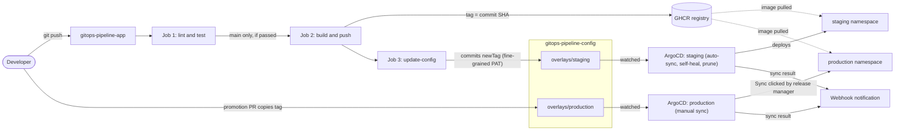

# GitOps Pipeline: From Commit to Production

An Express app whose every push is linted, tested and built in CI. Images go to GHCR, CI writes the new image tag into a separate GitOps config repo, and ArgoCD deploys to **staging automatically** and to **production only after manual approval**.

| Repo | Purpose |
|---|---|
| [gitops-pipeline-app](https://github.com/Thormie-Harshey/gitops-pipeline-app) (this repo) | Application code, tests, Dockerfile, CI pipeline |
| [gitops-pipeline-config](https://github.com/Thormie-Harshey/gitops-pipeline-config) | Kustomize base and overlays, ArgoCD manifests. The single source of truth for what runs |

## Workflow diagram



## Repo structure

```
gitops-pipeline-app/                  gitops-pipeline-config/
├── app.js        (routes)            ├── base/
├── server.js     (starts server)     │   ├── deployment.yaml
├── tests/        (Jest, Supertest)   │   ├── service.yaml
├── Dockerfile    (non-root, 1001)    │   └── kustomization.yaml
├── .github/workflows/ci.yml          ├── overlays/
├── screenshots/                      │   ├── staging/      (kustomization, resources-patch)
└── README.md                         │   └── production/   (kustomization, resources-patch)
                                      └── argocd/
                                          ├── project.yaml
                                          ├── staging-app.yaml
                                          ├── production-app.yaml
                                          └── notifications-cm.yaml
```

## How it works

**CI (`.github/workflows/ci.yml`)** runs three chained jobs:

1. **Lint and test** runs on every push to any branch: `npm ci`, ESLint, Jest with a 70% coverage threshold.
2. **Build and push** runs only on `main`, only if tests pass. It pushes `ghcr.io/thormie-harshey/gitops-pipeline-app:<commit SHA>` using the built-in `GITHUB_TOKEN` with `packages: write`.
3. **Update config** checks out the config repo with `CONFIG_REPO_TOKEN`, runs `kustomize edit set image` in `overlays/staging` only, and commits as `github-actions[bot]` with the message `staging: deploy gitops-pipeline-app@<short SHA>` plus a link back to the source commit. If two runs race, it rebases and retries up to three times.

Images are tagged with the **commit SHA**, never `latest`. Each tag is immutable, every deployment traces back to exact code, and a changed tag is what produces a new config commit for ArgoCD to act on.

**Kustomize:** the base holds everything both environments share (port, probes, security context). Each overlay sets its namespace, its image tag (`newTag:`), and a strategic merge patch for replicas and resources.

**ArgoCD** watches the overlays, not the app repo. It compares the desired state in Git with the live state in the cluster and reconciles any difference according to each app's sync policy.

## Environments

| | Staging | Production |
|---|---|---|
| Overlay | `overlays/staging` | `overlays/production` |
| Tag updated by | CI, automatically | Promotion pull request |
| Sync | Automated | Manual (Sync button) |
| Self-heal | On | Off (drift shows as OutOfSync) |
| Prune | On | Only during a manual sync |
| Replicas | 1 | 3 |
| CPU request / limit | 50m / 200m | 100m / 500m |
| Memory request / limit | 64Mi / 128Mi | 128Mi / 256Mi |

Health and sync are separate checks. An app can be **Healthy** (pods working) and **OutOfSync** (cluster differs from Git) at the same time.

## Setup instructions

**Prerequisites:** Docker, kind, kubectl, Git, GitHub CLI (`gh`), a GitHub account.

1. **Create the CI token.** GitHub Settings, Developer settings, Fine-grained tokens. Access: only `gitops-pipeline-config`. Permission: Contents read and write. Set an expiry date.
2. **Store it.** In this repo: Settings, Secrets and variables, Actions, new secret `CONFIG_REPO_TOKEN`.
3. **Run CI once** by pushing to `main`, then set the GHCR package to **Public** (Package settings, Change visibility) so the cluster can pull without a pull secret.
4. **Create the cluster:**
```bash
   kind create cluster --name gitops
```
5. **Install ArgoCD:**
```bash
   kubectl create namespace argocd
   kubectl apply -n argocd --server-side --force-conflicts \
     -f https://raw.githubusercontent.com/argoproj/argo-cd/stable/manifests/install.yaml
   kubectl wait --for=condition=Ready pods --all -n argocd --timeout=900s
```
6. **Bootstrap the project and apps** (from the config repo; the `argocd/` folder is applied once by hand, ArgoCD itself watches only the overlays):
```bash
   kubectl apply -f argocd/project.yaml
   kubectl apply -f argocd/staging-app.yaml -f argocd/production-app.yaml
```
7. **Notifications:** store the webhook URL as a Secret (never in Git), then apply the ConfigMap:
```bash
   read -rp "Paste webhook URL: " WEBHOOK_URL
   kubectl -n argocd patch secret argocd-notifications-secret --type merge \
     -p "{\"stringData\":{\"webhook-url\":\"$WEBHOOK_URL\"}}"
   kubectl apply -f argocd/notifications-cm.yaml
```
8. **Open the dashboard:**
```bash
   kubectl port-forward svc/argocd-server -n argocd 8080:443
   kubectl -n argocd get secret argocd-initial-admin-secret -o jsonpath="{.data.password}" | base64 -d; echo
```
   Browse to `https://localhost:8080`, log in as `admin`.
9. **First production release:** staging deploys itself. Production shows OutOfSync until you click **Sync, Synchronize**.

## Promotion process (staging to production)

1. **Verify in staging.** CI has deployed the new tag to staging. Confirm the app behaves correctly.
2. **Propose.** In the config repo, create a branch, copy the staging `newTag:` into `overlays/production/kustomization.yaml`, commit, and open a pull request.
```bash
   git switch main && git pull
   TAG=$(grep newTag overlays/staging/kustomization.yaml | awk '{print $2}')
   git switch -c promote/${TAG::7}
   sed -i "s/newTag: .*/newTag: $TAG/" overlays/production/kustomization.yaml
   git commit -am "production: promote gitops-pipeline-app@${TAG::7}"
   git push -u origin promote/${TAG::7}
   gh pr create --base main --title "Promote gitops-pipeline-app@${TAG::7} to production" --body "Verified in staging."
```
3. **Approve and merge** with **Squash and merge**, so each release is one commit. Production turns OutOfSync.
4. **Release.** Click **Sync, Synchronize** on the production app in ArgoCD.

This gives two gates (reviewed PR, then manual sync), an audit trail of every release, and a one-commit rollback.

## Drift detection and rollback

**Drift:** a manual `kubectl` change to staging is reverted by self-heal within seconds. The same change to production is left in place and shown as OutOfSync until someone syncs.

**Rollback:** revert the release commit in the config repo, then sync production.
```bash
git revert --no-edit <promotion commit SHA>
git push
```
The old image already exists in GHCR, so nothing is rebuilt and recovery is fast. `git revert` adds a new commit rather than deleting history, so the audit trail shows both the release and the rollback. Rolling back by reverting the app repo would instead trigger a full rebuild and a new image (a roll-forward).

## Security

- **No secrets in Git.** The CI token is a GitHub Actions secret; the webhook URL is a Kubernetes Secret created by hand.
- **Least privilege.** The CI token can only write contents to the config repo, and expires. GHCR pushes use the short-lived built-in `GITHUB_TOKEN`.
- **Public image, no pull secret** stored anywhere.
- **AppProject `gitops-pipeline`** allows one source repo, two destination namespaces, and only Namespace, Deployment and Service resources.
- **RBAC roles:** `developer` can view both apps and sync staging only; `release-manager` can sync production.
- **Production requires manual approval:** no `automated` sync policy.
- **Hardened pods:** non-root user 1001, no privilege escalation, all Linux capabilities dropped.

## Extras

- ArgoCD **webhook notifications** on sync success and failure (app, status, phase, revision, time).
- **Traceable commits:** every config commit names and links the app commit it deploys.
- **Race-safe CI:** the config update rebases and retries if two pipelines push at once.
- **Provenance attestation** attached to each image by Docker Buildx.

## Evidence

| # | Shows |
|---|---|
| [01](screenshots/01-local-tests-pass.png) | Tests pass locally, 100% coverage |
| [02](screenshots/02-ci-run-green.png) | First CI run green |
| [03](screenshots/03-overlay-diff.png) | Staging and production differ only in namespace, replicas, resources |
| [04](screenshots/04-config-repo-token-secret.png) | `CONFIG_REPO_TOKEN` stored as a secret |
| [05](screenshots/05-ci-three-jobs-green.png) | Three chained CI jobs green |
| [06](screenshots/06-bot-commit-staging-tag.png) | Bot commit updating the staging tag |
| [07](screenshots/07-dashboard-before-prod-sync.png) | Staging synced, production waiting |
| [08](screenshots/08-production-sync-panel.png) | Manual sync approval panel |
| [09](screenshots/09-production-first-release.png) | First production release |
| [10](screenshots/10-running-versions-per-env.png) | Different image per environment |
| [11](screenshots/11-ci-green-v2.png) | Code change: CI green |
| [12](screenshots/12-argocd-staging-auto-synced.png) | Staging auto-synced the change |
| [13](screenshots/13-staging-v2-production-old.png) | Staging serves v2, production unchanged |
| [14](screenshots/14-promotion-pr.png) | Promotion pull request |
| [15](screenshots/15-production-outofsync-after-merge.png) | Production OutOfSync after merge |
| [16](screenshots/16-production-v2-after-manual-sync.png) | Production serves v2 after manual sync |
| [17](screenshots/17-staging-drift-self-healed.png) | Staging drift reverted by self-heal |
| [18](screenshots/18-production-drift-outofsync.png) | Production drift held as OutOfSync |
| [19](screenshots/19-rollback-revert-commit.png) | Rollback revert commit |
| [20](screenshots/20-production-rolled-back.png) | Production back on the previous version |
| [21](screenshots/21-webhook-sync-notifications.png) | Sync notifications received |

## Known limitations

- **Single-node kind cluster:** replicas protect against pod failure, not node failure.
- **Kubernetes Secrets are base64-encoded, not encrypted.** Sealed Secrets or External Secrets would add encryption.
- **The CI token expires** and must be rotated.
- **RBAC roles are defined but not tested with tokens** in this demo; access was via the `admin` account.
